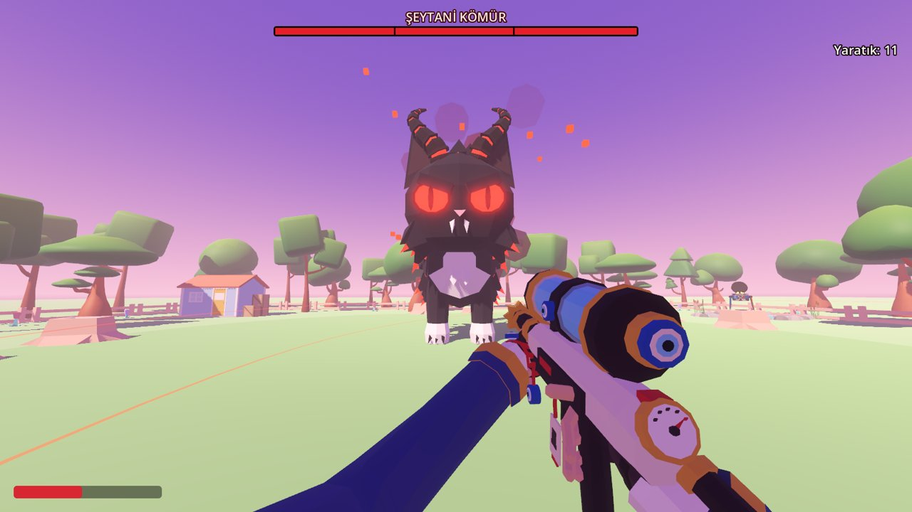
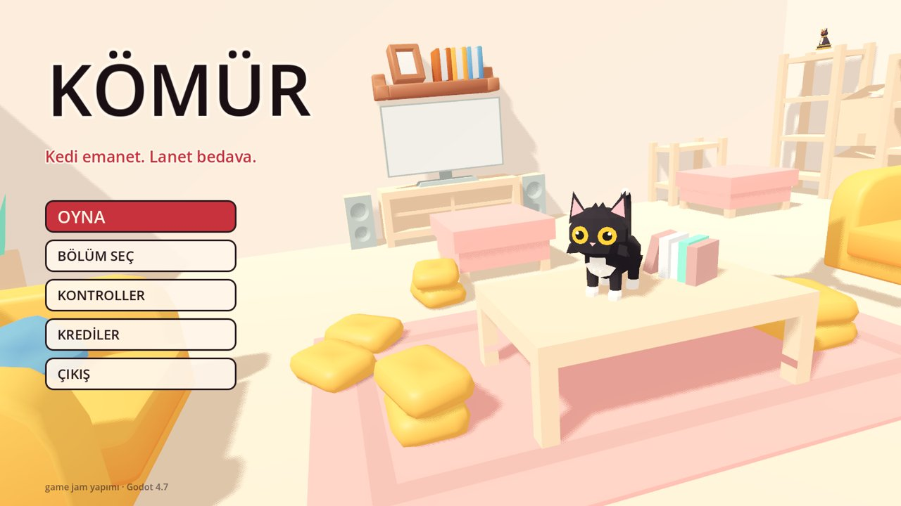
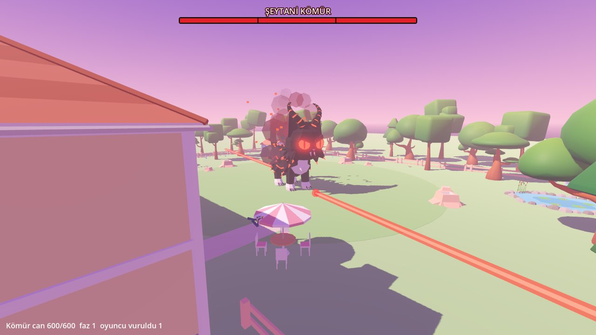
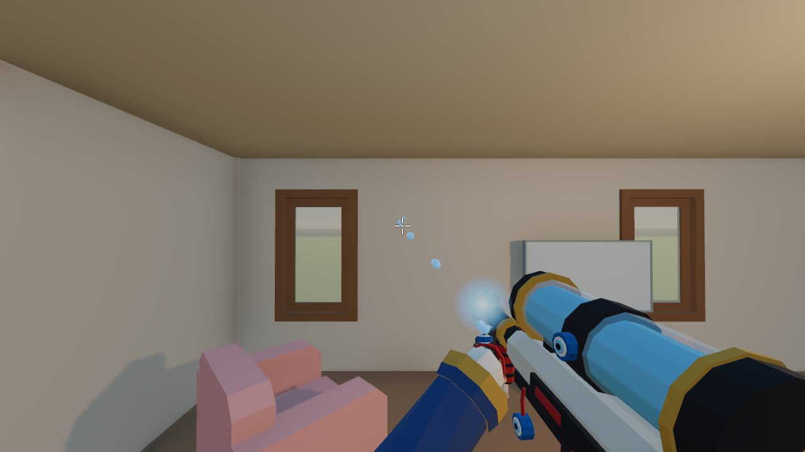

# Demonicat

Siyah kedi **Kömür**'ün şeytani bir hâle büründüğü, birinci şahıs bakışlı bir aksiyon oyunu. İki kişilik bir game jam projesi.

> 🔒 Kaynak kod şimdilik kapalı. Oyunu [Releases](https://github.com/HalittBulut/demonicat/releases/latest) sayfasından indirip oynayabilirsin.

## Oynanış

- Akıcı FPS hareketi: koşma, zıplama, eğilme, kayma ve **slide-hop**
- Su tabancası, kılıç ve silah arasında geçiş, su deposunu doldurma
- Kovalayan yaratıklar ve Kömür'ün davranışları
- Kapı, eşya ve fiş gibi etkileşimli nesneler
- Bahçede şeytani Kömür ile çok aşamalı boss savaşı: lazer saldırısı, sersemletme, can barı

| Ana menü | Lazer saldırısı | Su tabancası |
|---|---|---|
|  |  |  |

## İndir ve oyna

[Releases](https://github.com/HalittBulut/demonicat/releases/latest) sayfasından `Demonicat_Oyun.zip` dosyasını indir, bir klasöre çıkar ve `Demonicat.exe` dosyasını çalıştır. Windows 10/11 64-bit ve Vulkan destekli ekran kartı gerekir. Windows "bilinmeyen yayıncı" uyarısı verirse "Ek bilgi" → "Yine de çalıştır".

## Durum

Game jam sürümü tamamlandı ve yayınlandı.

## Görev dağılımı

| Kim | Ne yaptı |
|---|---|
| **Halit Bulut** | Oynanış ve Godot tarafı: proje kurulumu, FPS hareket sistemi, silah mekanikleri, yaratık ve Kömür davranış kodu, bölüm kurulumu |
| **Furkan** | Hikâye ve asset tarafı: hikâye ve akış, Blender'da tüm modeller ve materyaller, ses ve arayüz |

## Teknik

- Godot 4 · GDScript
- Blender modellerini oyuna bağlayan yazılı bir **asset sözleşmesi**: ölçek, eksen yönü, pivot noktası ve hareketli parçaların adları baştan sabitlendi. Böylece iki kişi birbirini beklemeden paralel çalıştı.
- Git ile ortak çalışma, klasör bazlı sorumluluk ayrımı

## Kontroller

| Tuş | İşlev |
|---|---|
| W A S D | Yürü |
| Shift | Koş |
| Space | Zıpla |
| Ctrl / C | Eğil / kay |
| Sol tık / Sağ tık | Ateş et / nişan al |
| 1 · 2 · Q | Su tabancası · kılıç · silah değiştir |
| R | Su deposunu doldur |
| E | Etkileşim |
